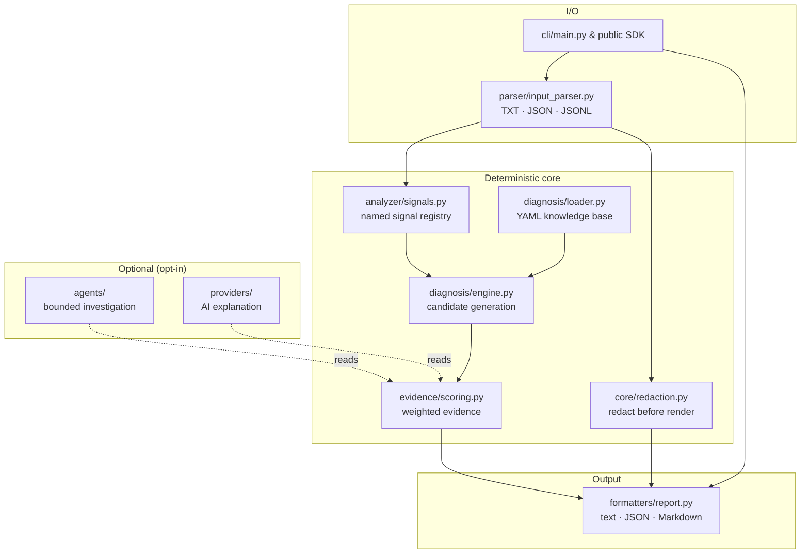

# Architecture overview

DEDoc is layered so the deterministic diagnosis path stays small, testable, and
dependency-free — optional capabilities (investigation, AI explanation) are
added around it, never inside it.

## Layers

| Layer | Module | Responsibility |
| --- | --- | --- |
| Input | `dedoc/parser/input_parser.py` | Tolerant parsing of text, JSON, and JSONL into normalized events |
| Signals | `dedoc/analyzer/signals.py` | Named regex signals; `exact=True` marks verified error signatures |
| Knowledge base | `dedoc/diagnosis/loader.py` | Loads and validates versioned YAML definitions from `diagnoses/` |
| Engine | `dedoc/diagnosis/engine.py` | Generates candidate diagnoses from signals and exception types |
| Scoring | `dedoc/evidence/scoring.py` | Weighted evidence, candidate ranking, confidence bands |
| Redaction | `dedoc/core/redaction.py` | Masks secrets before any excerpt is rendered |
| Output | `dedoc/formatters/report.py` | Renders text, JSON, and Markdown reports |
| Investigation | `dedoc/agents/` | Bounded, read-only context probes (optional) |
| AI explanation | `dedoc/providers/` | Provider-based narrative, opt-in and redacted (optional) |

## Mode terminology

- **Deterministic mode** — the default path. No AI, no network, no keys; the
  same input always yields the same diagnosis.
- **Investigation mode** — optional corroboration/contradiction checks against
  structured context (runs, schemas, metrics, query plans, logs).
- **AI explanation mode** — an optional plain-language narrative on top of the
  deterministic result. It never changes the diagnosis.

## The deterministic core

1. **Ingest & normalize** — parse the input into one or more `FailureEvent`s.
   Malformed input fails cleanly; files over 10 MiB are rejected.
2. **Detect platform** from explicit fields or markers in the failure text.
3. **Extract signals** — match the registry and record declared exception types.
- **Load the knowledge base** — every `diagnoses/**/*.yaml` definition is loaded
  and validated once per run.
- **Score candidates** — each definition accrues weighted evidence; see the
  [confidence model](confidence-model.md).
- **Select and render** — the top candidate above the threshold becomes the
  diagnosis; otherwise DEDoc abstains (`insufficient_evidence`).

## Optional: investigation mode

When structured context exists, the bounded agent selects probes from the top
hypothesis, invokes only allowlisted read-only tools, and stops at the first
**contradiction**. It abstains (`insufficient_context`) with no context and
enforces hard limits on iterations, tool calls, and wall-clock time. See the
[CLI reference](../reference/cli.md#structured-investigation-optional).

## Optional: AI explanation

`dedoc/providers/` is a stdlib-only provider layer. Keys come only from
`DEDOC_AI_*` environment variables and `ProviderConfig` is secret-free. Before
anything is sent, the payload is re-redacted and bounded. AI is never on by
default and never blocks the deterministic report. See
[Security & privacy](security-model.md).

## Design constraints

- **No new runtime dependencies.** The deterministic path and providers use only
  the standard library.
- **Deterministic and reproducible.** AI never influences the diagnosis itself.
- **Evidence over certainty.** A diagnosis is only reported when its top
  candidate clears the [score threshold](confidence-model.md).

!!! tip "See also"
    - [Confidence model](confidence-model.md)
    - [Security & privacy](security-model.md)
    - [Full diagnosis reference](../reference/diagnosis-reference.md)
