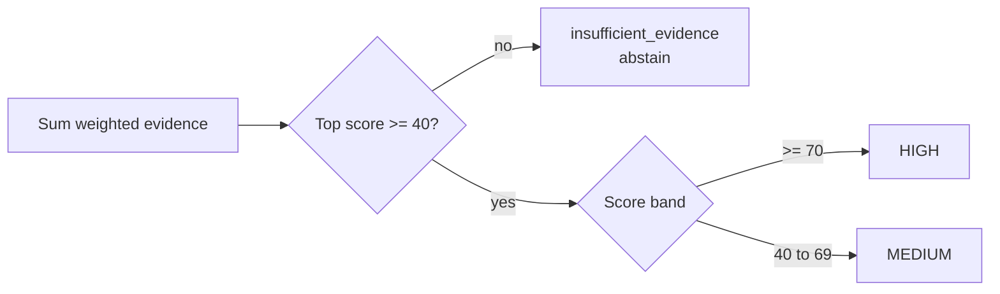

# Confidence model

Every diagnosis score is built from weighted evidence. There is no guessing —
if the evidence isn't there, DEDoc abstains. This page explains the weights, the
thresholds, and works through a full example.

## Evidence weights

| Evidence | Weight | Source |
| --- | --- | --- |
| Exact error signature | **40** | A verified error token registered with `exact=True` |
| Correlated runtime signal | **15** | A behavioral indicator (not a verified error token) |
| Declared exception observed | **20** | The exception type appears in the stack trace |
| Platform match | **20** | The detected platform is supported by the diagnosis |
| Runtime metadata | **5** | Structured fields such as job, stage, or task |

The weights and versioned thresholds live in `dedoc/evidence/` and are derived
from `BUILD_PLAN.md` §10.

## Thresholds

| Score | Result |
    | --- | --- |
| `< 40` | **Insufficient evidence** — no diagnosis reported |
| `40 – 69` | **MEDIUM** confidence |
| `>= 70` | **HIGH** confidence |

A diagnosis is only reported when its top candidate reaches **40**. An exact
error signature alone (40) is exactly at the boundary; a correlated runtime
signal alone (15) never is.

## Worked example: executor OOM

For a Spark log containing a real `java.lang.OutOfMemoryError` stack trace in a
Spark job, the top candidate `DEDOC-SPARK-001` accumulates:

| Evidence | Weight |
| --- | --- |
| Exact error signature matched: `executor_oom` | +40 |
| Declared exception observed: `OutOfMemoryError` | +20 |
| Platform detected: `spark` (diagnosis supports spark, databricks) | +20 |
| **Total** | **80 → HIGH** |

For a structured ADF failure (a JSON event carrying `"platform": "adf"`), a
linked-service failure scores `40` (exact) + `20` (platform match) + `5`
(metadata) = **65 → MEDIUM** — enough to report, but honestly short of HIGH.

## Why weighted evidence

- **No black box.** Every point in the score is attributable to a named signal
  or a declared fact.
- **No guessing.** Below the threshold DEDoc returns
  `insufficient_evidence` instead of a low-confidence guess.
- **Calibrated bands.** HIGH means multiple independent signals agree; MEDIUM
  means the evidence is real but thinner.

The evidence, its weight, and the source excerpt are printed in every report —
see the [CLI reference](../reference/cli.md#example-output).

!!! tip "See also"
    - [Diagnosis catalog](../reference/diagnosis-catalog.md)
    - [Full diagnosis reference](../reference/diagnosis-reference.md)
    - [Architecture overview](architecture.md)
