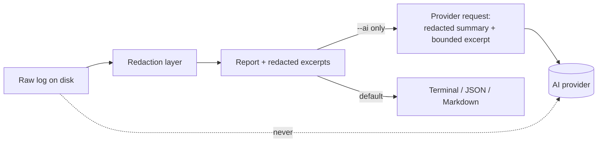

# Security & privacy

DEDoc processes potentially untrusted failure logs, so redaction and read-only
operation are first-class design constraints. This page covers the trust model,
what is redacted, and exactly what leaves your machine.

## Principles

- **Redact before rendering.** Every excerpt is redacted before it is printed.
- **Tolerant input.** Parsing never crashes on malformed input.
- **Bounded input.** Files over 10 MiB are rejected.
- **Read-only diagnosis.** The engine only reads files and prints reports; it
  never writes to user data, runs other programs, or mutates production
  resources.
- **Offline by default.** The only network call in the default path is the
  documentation link-check used by `make verify`. AI is opt-in.

## Redaction

Before anything is printed as a report or excerpt, log content passes through a
redaction layer (`dedoc/core/redaction.py`) that:

- masks URLs with credentials and secret-bearing query parameters (SAS, tokens,
  signatures);
- masks common secret names and assignments (`secret`, `token`, `password`,
  `api_key`, `client_secret`, `sas_key`, …);
- masks authorization headers, bearer tokens, AWS access-key IDs, Databricks
  PAT-style tokens, and entire private-key blocks;
- clamps excerpts to a bounded length.

Evidence excerpts are always the redacted form.

## Trust boundaries

| Boundary | Guarantee |
| --- | --- |
| Input parsing | Tolerant; never crashes on malformed input |
| Input size | Over 10 MiB is rejected |
| Filesystem | Read-only; no writes to user data locations |
| Execution | No subprocesses, no mutation of production resources |
| Network | None in deterministic mode (only the docs link-check in `make verify`) |

## Investigation mode guarantees

Investigation mode is **deterministic and read-only**:

- probes are read-only only;
- the tool surface is allowlisted (`get_metrics`, `get_schema`, `compare_runs`,
  `inspect_query_plan`, `search_logs`, `search_knowledge_base`, …);
- hard limits on iterations, tool calls, and wall-clock time are enforced.

## AI explanation mode: what leaves the machine

AI is a strictly optional layer. When you enable it (`--ai` or `ai=True`) with a
configured provider (`DEDOC_AI_PROVIDER`), the only data sent out is:

- the **redacted** report summary — status, top diagnosis, matched signals,
  evidence descriptions and redacted excerpts, recommendations;
- a bounded (a few thousand characters), **re-redacted** excerpt of the input;
- the API key, in a request **header** to the configured provider only.

Guarantees enforced by tests:

- Secrets in the raw log cannot survive into the bytes sent to a provider.
- API keys are only ever read from the environment; `ProviderConfig` and
  reports never contain them.
- If a provider is unavailable, AI is skipped and the deterministic report
  still succeeds.
- The provider layer performs no logging; raw logs never reach provider
  telemetry.

## Reporting a vulnerability

Do **not** open a public issue for security problems. Email the maintainers via
the contact published in [`SECURITY.md`](https://github.com/Adez017/Data-Engineer-Doctor/blob/main/SECURITY.md)
at the repository root, including a minimal reproduction and any proposed patch.
Coordinated disclosure is appreciated; the project aims to respond within seven
days.

## Supply chain

- Dependencies are pinned by `uv.lock` and audited with `pip-audit` in CI and in
  `make verify`.
- Ruff, mypy (strict), and the full test suite gate every change.
- A reference-URL check prevents dead or invented links in diagnosis YAMLs.

!!! tip "See also"
    - [Architecture overview](architecture.md)
    - [Configuration](../how-to/configuration.md)
    - [Troubleshooting](../how-to/troubleshooting.md)
