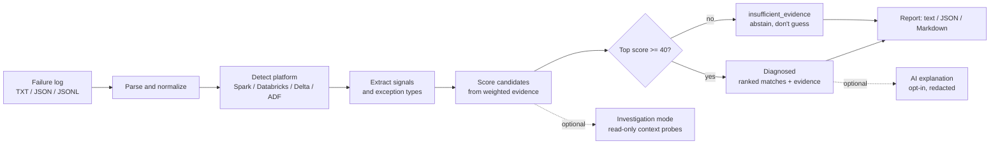

# Data Engineer Doctor

<div class="dedoc-hero">
  
  <p class="dedoc-tagline">Evidence-driven diagnosis for data engineering failures.</p>
  <div class="dedoc-hero-actions">
    <a class="dedoc-cta dedoc-cta-primary" href="tutorial/first-diagnosis/">Get started</a>
    <a class="dedoc-cta dedoc-cta-secondary" href="how-to/installation/">Install</a>
    <a class="dedoc-cta dedoc-cta-secondary" href="reference/cli/">CLI reference</a>
  </div>
</div>

**Data Engineer Doctor (DEDoc)** turns a failure log — a Spark stack trace, a
Delta error, a Databricks job output, an Azure Data Factory pipeline run — into
a ranked, **evidence-backed** root cause with the next actions to take. It is
deterministic by default: the same input always yields the same diagnosis, and
no AI or API key is required.

<div class="dedoc-grid dedoc-grid-feature">
  <div class="dedoc-card">
    <h3>Deterministic</h3>
    <p>The same log always produces the same diagnosis, with every score traceable to a weighted signal.</p>
  </div>
  <div class="dedoc-card">
    <h3>Explainable</h3>
    <p>Reports cite the exact evidence and confidence band, and abstain when there isn't enough signal.</p>
  </div>
  <div class="dedoc-card">
    <h3>Adoption-friendly</h3>
    <p>One command, no keys. Add structured investigation or an optional AI explanation only when you want it.</p>
  </div>
</div>

## Quickstart

=== "Install"

    ```bash
    pip install -e .
    ```

    See [Installation](how-to/installation.md) for development and CI setups.

=== "Diagnose"

    ```bash
    dedoc diagnose path/to/error.log
    ```

=== "Automate"

    ```bash
    dedoc diagnose path/to/error.log --format json
    ```

From source you can also try the bundled samples:

```bash
make examples
```

## What a report looks like

```text
Data Engineer Doctor
Input:     logs/executor-oom.log
Platform:  spark
Status:    diagnosed
Confidence: HIGH

What we found:
  DEDOC-SPARK-001 Executor Out of Memory
  Severity: critical | Platforms: spark, databricks
  Confidence: HIGH (80/100)
  Matched signals: Executor OOM

Evidence:
  1. Exact error signature matched: executor_oom (+40)
  2. Declared exception observed in stack trace: OutOfMemoryError (+20)
  3. Platform detected: spark (+20)

What to do next:
  Immediate: ...
```

See the full [CLI reference](reference/cli.md) for text, JSON, and Markdown
output and the [confidence model](explanation/confidence-model.md) for how the
score is built.

## How it works



1. **Parse** the log (tolerant, size-bounded, secret-redacting).
2. **Detect the platform** from markers in the failure.
3. **Extract named signals** and declared exception types.
4. **Score every candidate diagnosis** from weighted evidence.
5. **Report the top match**, or **abstain** when nothing clears the threshold.

Read more in the [Architecture overview](explanation/architecture.md).

## Coverage at a glance

<div class="dedoc-grid dedoc-grid-metrics">
  <div class="dedoc-card dedoc-metric">
    <h3>39</h3>
    <p>bundled diagnoses</p>
  </div>
  <div class="dedoc-card dedoc-metric">
    <h3>7</h3>
    <p>platform &amp; fault domains</p>
  </div>
  <div class="dedoc-card dedoc-metric">
    <h3>Python</h3>
    <p>3.11 / 3.12</p>
  </div>
</div>

Domains: **Spark**, **Databricks**, **Delta**, **Schema**, **Data Quality**,
**Connectivity**, and **Azure Data Factory** — see the
[diagnosis catalog](reference/diagnosis-catalog.md) and the
[full diagnosis reference](reference/diagnosis-reference.md).

## Choose your path

<div class="dedoc-grid dedoc-grid-feature">
  <div class="dedoc-card">
    <h3>I'm new</h3>
    <p><a href="tutorial/first-diagnosis/">Start the tutorial</a> · <a href="how-to/installation/">Install</a></p>
  </div>
  <div class="dedoc-card">
    <h3>I'm wiring it in</h3>
    <p><a href="how-to/github-action/">GitHub Action</a> · <a href="reference/cli/">CLI reference</a> · <a href="reference/sdk/">Python SDK</a></p>
  </div>
  <div class="dedoc-card">
    <h3>I'm curious how</h3>
    <p><a href="explanation/architecture/">Architecture</a> · <a href="explanation/confidence-model/">Confidence model</a> · <a href="explanation/security-model/">Security &amp; privacy</a></p>
  </div>
</div>

!!! tip "See also"
    - [When to use DEDoc](how-to/when-to-use.md)
    - [Troubleshooting](how-to/troubleshooting.md)
    - [Top 25 user queries map](reference/top-25-queries.md)
